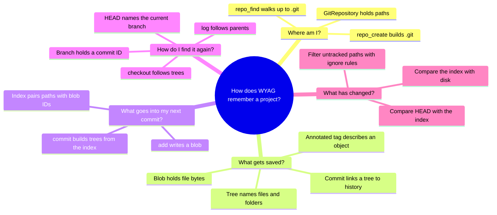

# WYAG • A mind map and guided reading of libwyag.py

Imagine you stage your viva notes, edit them again, and then commit. Which version goes into history? We’ll answer that by following one file through the Python source of *Write yourself a Git!* The function names and line numbers below refer to the copy of `libwyag.py` in the RIZZ project.

## Mind map

Read each branch as a question you can ask the code.



## 1. Where does a command start?

Find `main` at line 49. When the user types `wyag add notes/viva.txt`, Python’s argument parser separates the command (`add`) from its input (`notes/viva.txt`). The matching case calls `cmd_add(args)`. That short wrapper finds the repository and hands the paths to `add`. When reading a new command, jump first to its `cmd_` function. It tells you which helpers do the work.

`GitRepository` (69) keeps the **worktree**, the folder where you edit files, and the **gitdir**, the hidden folder where WYAG keeps its records. If you run a command inside the `notes` subfolder, `repo_find` (182) checks that folder, then its parent, until it finds a `.git` directory.

| Open this path | What you learn |
| --- | --- |
| `.git/HEAD` | Which branch is active. This source writes `ref: refs/heads/master` during initialization. |
| `.git/refs/heads/master` | Which commit that branch currently points to. The file appears on the first commit. |
| `.git/index` | Which version of each tracked file is selected for the next snapshot. Before staging anything, a missing index reads as an empty index. |
| `.git/objects/` | Where WYAG stores blobs, trees, commits, and annotated tags by ID. |
| `.git/refs/tags/` | Names given to particular objects, such as a release tag. |
| `.git/config` | Repository settings created by `repo_create` (126). |

## 2. How does Python turn a file into a Git object?

Start with `object_write` (261). Suppose a file contains the four letters `blob` followed by a newline. There are **five bytes** of content. Here is the calculation in a small, standalone Python example.

```python
import hashlib

content = b"blob\n"
header = b"blob 5\x00"
object_id = hashlib.sha1(header + content).hexdigest()
```

The first `blob` in the calculation is a type label. The second one happens to be what the student typed in the file. The zero byte marks where the header ends. When given a repository, `object_write` compresses these same header-plus-content bytes with zlib and saves them under the ID. The first two hex digits select a folder and the remaining digits form the filename. A second file with the same bytes reuses the same blob. Each filename lives separately in a tree entry.

`object_read` (227) reverses the storage steps. It opens the object by ID, decompresses it, checks the declared size and reads the type label. If the label says `blob`, it constructs a `GitBlob` from the payload. If it says `tree`, it constructs a `GitTree`. This reader handles loose objects, meaning one object per file.

### Where OOP helps in RIZZ

| Python class | What an instance represents | What serialization does |
| --- | --- | --- |
| `GitObject` (203) | Common interface for stored objects | Defines the operations child classes supply. |
| `GitBlob` (279) | One file’s contents, including binary data | Returns the stored bytes directly. |
| `GitTree` (545) | One directory listing | Encodes entries. Each `GitTreeLeaf` (483) holds a mode, a name and the ID of the child. |
| `GitCommit` (426) | A snapshot plus the information needed to place it in history | Encodes fields such as tree, parent and author, then the message. |
| `GitTag` (684) | An annotated tag object | Inherits the commit class’s field-and-message format. Its fields describe the tagged object. |

Look at the call `obj.serialize()` inside `object_write`. The storage function can save any of these objects. Python chooses the method belonging to the object passed in. In a C++ viva, this is the example to use for **runtime polymorphism**. A base-class reference calling a virtual `serialize()` can express the same idea.

## 3. Follow one file through add, edit and commit

The following sequence was checked against the project’s Python implementation in a temporary repository with a configured user name and email. Commands use the tutorial’s `wyag` launcher. The word after each `printf` is followed by a newline.

```sh
wyag init demo
cd demo
mkdir notes
printf 'blob\n' > notes/viva.txt
wyag add notes/viva.txt
printf 'tree\n' > notes/viva.txt
wyag commit -m "Study blobs"
wyag status
wyag checkout HEAD ../saved
cat ../saved/notes/viva.txt
```

| Moment | Working file | Index entry points to | Latest commit contains |
| --- | --- | --- | --- |
| After writing the file | blob | No entry | No commit |
| After add | blob | Blob containing “blob” | No commit |
| After the second edit | tree | Blob containing “blob” | No commit |
| After commit | tree | Blob containing “blob” | blob |

**During add.** Read `add` (1386). It first calls `rm` with `delete=False` to clear any older index entry for the path while keeping the working file. It opens the file in binary mode and calls `object_hash`, which constructs a blob and passes it to `object_write`. Then it appends a `GitIndexEntry` containing the relative path, the blob ID and filesystem metadata. Finally, `index_write` saves the updated list. Editing the file afterward changes only the working copy.

**During commit.** Read `cmd_commit` (1540). Its input is the saved index. `tree_from_index` (1454) groups entries by directory and processes the deepest paths first. In this example it writes a tree for `notes` containing an entry called `viva.txt`. Now it has the ID it needs to put a `notes` entry into the root tree. This order answers a practical question: how could a parent store its child’s ID before the child has been written?

Next, `commit_create` (1517) records the root tree ID, author, time and message. On later commits it also records the previous commit as a parent. It writes the commit and returns its ID. On the active branch, `cmd_commit` puts that ID in `.git/refs/heads/master`. The next time WYAG follows HEAD, it reaches the new commit.

**During status.** Read `cmd_status` (1146). The first comparison flattens the committed tree into a path-to-ID dictionary and compares it with the index. Here they agree. The second comparison checks index entries against working files. Changed timestamps prompt WYAG to hash the file again. Here the bytes differ, so it reports `notes/viva.txt` under “Changes not staged for commit.” For files absent from the index it consults ignore rules before listing them as untracked.

**During checkout.** Read `cmd_checkout` (599) and `tree_checkout` (619). WYAG follows the commit to the root tree, creates the `notes` directory in the destination, follows the `viva.txt` entry and writes the blob’s bytes. The last command prints **blob**. Your original working copy still says **tree**. This tutorial’s checkout exports into a new or empty directory.

## 4. How do I read history and look things up?

A commit has two kinds of links worth following. Follow its **tree** to ask “what files existed then?” Follow its **parent** to ask “what came before?” Two commits with different messages can share the same root tree. Two trees with different filenames can share a blob. The IDs let unchanged parts of the project be reused.

| Question | Command | Where to look in the Python file |
| --- | --- | --- |
| What ID would these bytes get? | `hash-object` | `object_hash` (337) picks an object class. The command’s `-w` option also stores the object. |
| What bytes are inside this object? | `cat-file` | `cat_file` (304) resolves the name, reads the object and outputs its serialized payload. |
| Which files belong to a snapshot? | `ls-tree` | `ls_tree` (570) prints entries. Recursive mode descends into subtrees. |
| How are commits related? | `log` | `log_graphviz` (452) follows parent IDs and emits Graphviz graph text. A set called `seen` prevents repeated visits to shared ancestors. |
| Which names point to objects? | `show-ref` | `ref_list` (651) walks the refs directory. `ref_resolve` (632) follows indirect names to an ID. |
| Which object does this name mean? | `rev-parse` | `object_resolve` (744) collects candidates for names and hash prefixes. `object_find` (796) checks ambiguity and can follow a commit to its tree. |
| What does a tag store? | `tag` | `tag_create` (717) writes a named reference. An annotated tag adds a tag object between that name and its target. |
| Which files are in the index? | `ls-files` | `cmd_ls_files` (1013) reads index entries and prints their paths. |
| Would ignore rules match this path? | `check-ignore` | `gitignore_read` (1076) gathers rules. `check_ignore` (1134) checks them for the given path. |
| How is a deletion staged? | `rm` | `rm` (1333) removes matching entries, optionally deletes working files and writes the index. Earlier commits still reference their saved blobs. |

## 5. Three parsing details to read on a second pass

- **Commit text.** In `kvlm_parse` (351), a blank line separates the fields from the message. The dictionary uses the Python key `None` for that message. Repeated fields can become a list, which lets the reader represent a commit with several parents. WYAG’s commit command itself supplies at most one parent.
- **Tree bytes.** In `tree_parse_one` (489), the parser reads a mode up to a space, a name up to a zero byte, and then exactly 20 bytes for the child ID. Twenty raw bytes become 40 hexadecimal characters for display. The function returns the next position so `tree_parse` can continue with the next entry.
- **Index bytes.** In `index_read` (901), the first 12 bytes identify the file, its format version and the number of entries. This reader expects index version 2. It then reads paths, object IDs and metadata into Python objects. The saved timestamps help `status` decide when a closer comparison is worthwhile.

**A useful viva question:** If you rename a file and commit the rename without changing its contents, which IDs change? The blob ID stays the same because the bytes stayed the same. The tree that contains the name gets a new ID, as do its ancestor trees. The new commit refers to the new root tree and links back to the previous commit.

**Source and scope.** Read this alongside the project’s `libwyag.py` and the [original WYAG tutorial](https://wyag.thb.lt/). The tutorial explains branches as references. A branch-switching command and a merge command would be additions to RIZZ.
